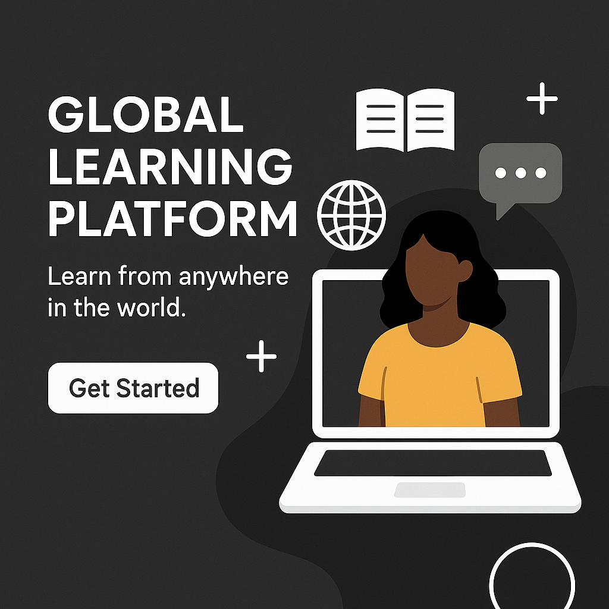
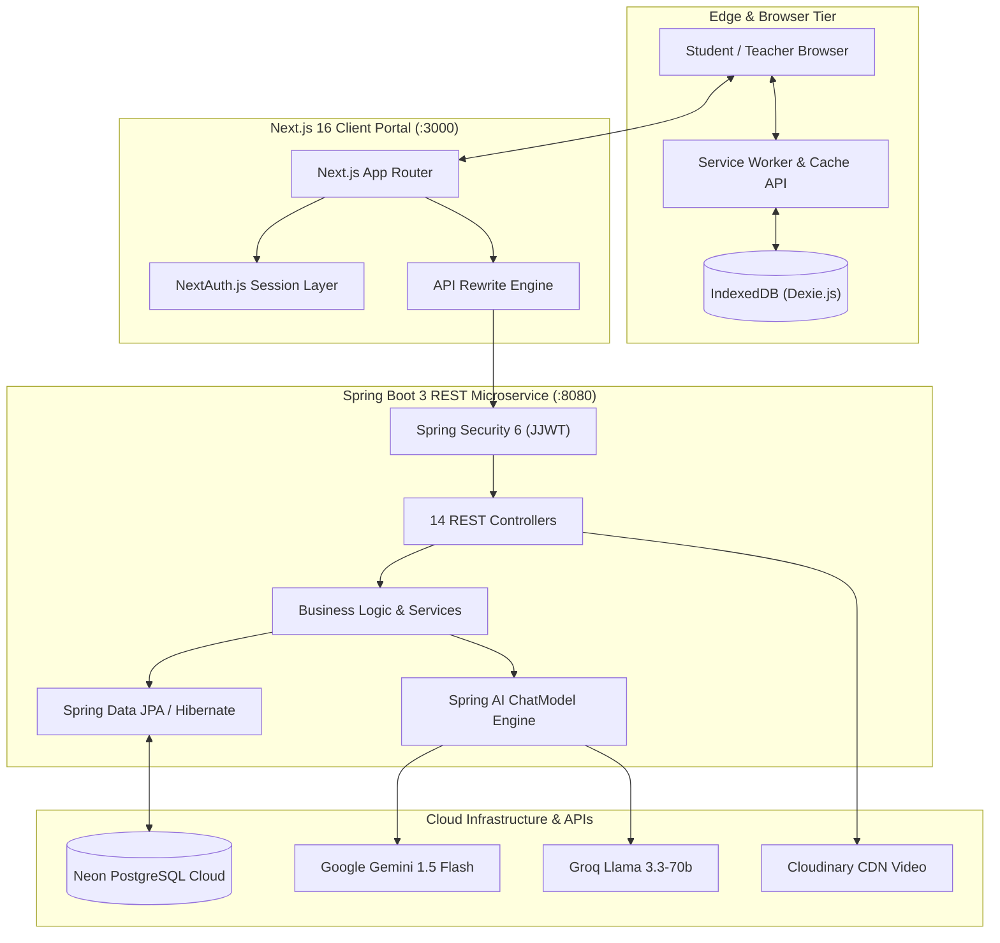

# EduNexus 🌐

<p align="center">
  
</p>

<p align="center">
  <strong>Learn Anywhere. Anytime. Together.</strong><br/>
  <em>Next-Generation Offline-First AI Learning Platform bridging the educational divide between rural and urban learners.</em>
</p>

<p align="center">
  <a href="https://edu-bridge-lac.vercel.app/"></a>
  <a href="http://localhost:8080/swagger-ui/index.html"></a>
  <a href="#"></a>
</p>

<p align="center">
  
  
  
  
  
  
</p>

---

> [!IMPORTANT]
> **EduNexus** is engineered from the ground up for resilience. Students in low-connectivity areas can download full course modules and practice quizzes into browser IndexedDB via a Progressive Web App (PWA). Once connectivity is re-established, progress and streaks automatically synchronize with the cloud.

---

## 📋 Table of Contents

- [Overview](#-overview)
- [Key Features](#-key-features)
- [System Architecture](#️-system-architecture)
- [Tech Stack](#-tech-stack)
- [Quick Start](#-quick-start)
- [Environment Configuration](#-environment-configuration)
- [Project Structure](#-project-structure)
- [Interactive API Documentation (Swagger)](#-interactive-api-documentation-swagger)
- [PWA & Offline Capability](#-pwa--offline-capability)
- [Contributing & License](#-license)

---

## 🌟 Overview

**EduNexus** bridges the digital learning gap by delivering high-quality, interactive education without requiring continuous high-speed internet. 

Powered by a decoupled **Next.js 16** edge frontend and a robust **Java 17 / Spring Boot 3.4.2** backend with **Spring AI**, EduNexus combines:
1. **Universal Offline Access**: Seamless client-side caching with Dexie.js (IndexedDB) and Service Workers.
2. **Multi-Tier AI Tutoring**: Intelligent LLM guidance using Google Gemini 1.5 Flash, Groq Llama 3.3, and offline local technical generators.
3. **Engaging Gamification**: Experience points (XP), daily streaks, rank progression, and competitive community leaderboards.
4. **Community Collaboration**: Real-time announcements, discussion threads, peer feedback, and instructor tooling.

---

## ✨ Key Features

### 🎓 1. Core Learning Experience
- **Course & Lesson Studio**: Rich markdown notes, YouTube video embeds, and direct Cloudinary CDN video streaming.
- **Progress & Time Tracking**: Microsecond-accurate learning session analytics and lesson completion gauges.
- **Offline Sync Engine**: Download entire course packs for offline revision, stored securely in client IndexedDB.

### 🤖 2. Spring AI Intelligence Engine
- **Multi-Tier AI Fallback Pipeline**:
  $$\text{Gemini 1.5 Flash} \longrightarrow \text{Groq Llama-3.3-70b} \longrightarrow \text{Local Domain Fallback}$$
- **Interactive AI Tutor**: 4 conversational modes (`General Discussion`, `Concept Deep Dive`, `Practical Coding`, `Debate / Socratic Method`).
- **Dynamic Quiz Generator**: Auto-generates structured multiple-choice assessments tailored to lesson content on-the-fly.

### 🎮 3. Gamification & Community
- **Streaks & XP**: Earn recognition and rewards for daily learning consistency.
- **Global Leaderboard**: Competitive peer rankings based on total points and verified course completions.
- **Discussion Forums**: Threaded question-and-answer boards with role badges (`Student`, `Teacher`).
- **Teacher Broadcasts**: Direct announcement distribution with instant student alerts.

### 🔐 4. Enterprise Security
- **Stateless JWT**: Spring Security 6 with JJWT (`0.12.6`) token verification.
- **Role-Based Access Control**: Strict route protection separating Student learning spaces from Teacher course authoring tools.

---

## 🏗️ System Architecture



---

## 🛠 Tech Stack

| Domain | Technology | Description |
| :--- | :--- | :--- |
| **Frontend Framework** | [Next.js 16](https://nextjs.org/) | App Router, React 19, Turbopack |
| **Styling & UI** | [Tailwind CSS v4](https://tailwindcss.com/) + [Radix UI](https://www.radix-ui.com/) | Modern design system, OKLCH theme colors |
| **Offline Storage** | [Dexie.js](https://dexie.org/) | Reactive IndexedDB storage wrapper |
| **Backend Framework** | [Spring Boot 3.4.2](https://spring.io/projects/spring-boot) | Enterprise Java 17 REST API microservice |
| **AI Integration** | [Spring AI](https://spring.io/projects/spring-ai) | Multi-model chat abstraction (Gemini + Groq) |
| **Database** | [Neon PostgreSQL](https://neon.tech/) | Serverless managed PostgreSQL AWS instance |
| **Security** | Spring Security 6 + JJWT | Stateless JSON Web Token authentication |
| **API Documentation** | OpenAPI 3 / [Swagger UI](http://localhost:8080/swagger-ui/index.html) | Interactive web interface for testing endpoints |
| **Media Hosting** | [Cloudinary](https://cloudinary.com/) | Optimized image and video streaming delivery |

---

## 🚀 Quick Start

### Prerequisites
- **Node.js** 20+ and **pnpm** (`npm install -g pnpm`)
- **Java JDK 17** or higher
- **Apache Maven 3.8+** (or bundled `./mvnw`)

---

### 1. Clone the Repository

```bash
git clone https://github.com/Grindor92352/-EduBridge-Education-Platform.git
cd Edu_Bridge
```

---

### 2. Configure Environment Variables

```bash
# Frontend environment
cp frontend/.env.example frontend/.env.local

# Backend environment
cp backend/.env.example backend/.env
```

---

### 3. Launch Backend Microservice (Spring Boot 3)

```bash
cd backend

# Linux / macOS
./mvnw spring-boot:run

# Windows PowerShell
.\mvnw.cmd spring-boot:run
```
> The backend REST server will start at **`http://localhost:8080`**.

---

### 4. Launch Frontend Portal (Next.js 16)

In a new terminal window:

```bash
cd frontend
pnpm install
pnpm dev
```
> The client web app will open at **`http://localhost:3000`**.

---

## 📜 Interactive API Documentation (Swagger)

EduNexus includes comprehensive Swagger OpenAPI 3 interactive documentation baked directly into the Spring Boot backend:

- **Swagger UI**: [http://localhost:8080/swagger-ui/index.html](http://localhost:8080/swagger-ui/index.html)
- **OpenAPI Specification**: [http://localhost:8080/v3/api-docs](http://localhost:8080/v3/api-docs)

You can explore endpoints, inspect request schemas, and execute authenticated test requests right from your browser.

---

## 📁 Project Structure

```
EduNexus/
├── 📁 backend/                        # Java 17 / Spring Boot 3 Backend
│   ├── 📁 src/main/java/com/edubridge/
│   │   ├── 📁 config/                 # OpenApiConfig & Swagger setup
│   │   ├── 📁 controller/             # 14 REST Controllers (Auth, Course, Forum, Quiz, AiTutor, etc.)
│   │   ├── 📁 dto/                    # AuthResponse, LoginRequest, UserDto
│   │   ├── 📁 model/                  # JPA Entities (User, Course, Lesson, Progress, etc.)
│   │   ├── 📁 repository/             # Spring Data JPA Repositories
│   │   ├── 📁 security/               # Spring Security 6 & JwtAuthenticationFilter
│   │   └── 📁 service/                # AuthService, AiTutorService, QuizAiService
│   ├── 📄 pom.xml                     # Maven build configuration with Spring AI
│   └── 📄 src/main/resources/application.yml
├── 📁 frontend/                       # Next.js 16 Client App
│   ├── 📁 app/                        # Next.js App Router (pages & server actions)
│   ├── 📁 components/                 # Reusable UI components & Dashboards
│   ├── 📁 lib/                        # Dexie offline db, auth, helpers
│   ├── 📁 styles/                     # Tailwind CSS & OKLCH color system
│   ├── 📄 next.config.mjs             # API rewrites proxying to :8080
│   └── 📄 package.json                # Frontend dependencies
├── 📄 package.json                    # Monorepo task runner
└── 📄 README.md                       # Repository documentation
```

---

## 📱 PWA & Offline Capability

EduNexus functions as an installable Progressive Web App (PWA):

1. **Desktop**: Click the **Install EduNexus** icon in Chrome/Edge address bar.
2. **Mobile**: Tap **Add to Home Screen** from Safari or Chrome options.
3. **Offline Access**: Complete exercises, review downloaded courses, and chat with local fallback tutors even with zero connectivity.

---

## 📄 License

This project is licensed under the MIT License - see the [LICENSE](LICENSE) file for details.
